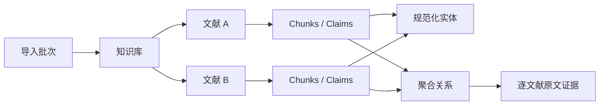

# 更新日志

按大版本归档 README 中的功能变更、修复记录、迁移背景和当时的验证说明；
各条记录中的开发与部署状态描述对应当时的改动。
当前项目特性和使用方法见 [README](README.md)。

## v3：全文目录、完整事实与证据问答

### 图谱节点整理与白底图片导出（2026-10-20）

“统一图谱”新增自动、层次和环形布局，支持间距调整、固定布局、多选拖动及标签页内位置恢复。
浅色节点框、长名称换行、静态平行/反向边与独立自环改善可读性，原有条件编号、否定/推测和
证据提示保留。图谱使用前端依赖中自带的渲染资源，不再依赖 CDN。

支持按整理后的完整子图导出不透明白底 PNG，可选 1×/2×/3×，图片保留关系方向、文字和类型图例。
导出不受视野缩放和平移影响，超大图片明确提示缩小范围或降低清晰度。
无需新增运行依赖、数据库迁移或重建图谱，仅需更新前端。

### 图谱实体类型配色补齐（2026-10-18）

修复前端只有 11 种预设颜色、其余 24 种实体类型统一回退为绿色的问题。
为当前全部 35 种类型设置独立颜色，保留已有预设配色；图谱上方显示当前子图的
实体类型图例，图例与节点共用颜色映射。未知或缺失类型沿用 Other 灰色。
实体类型筛选使用 API 词表。无需数据库迁移或重新抽取，容器部署需重建前端后生效。

### DOI 全文与附录补查（2026-10-18）

修复 PDF 只检索首页，以及 GROBID 页码完整时不补查缺失 DOI 的限制。
保留 GROBID 文献头与 PDF 元数据优先级，增加 GROBID 正文、附录、注释及链接目标
和 PDF 所有页的本地检索；即使 PDF 文字读取失败，仍可使用 GROBID 中的 DOI。
识别参考文献区域并跨页排除，进入附录或补充材料后恢复检索；排除明确的数据集、代码
和引用条目。候选按 DOI 大小写去重，有冲突且不能确认本文 DOI 时保留空值。
规范化常见换行、链接参数、尾随标点和多余右括号，保留 DOI 内合法的连字符及括号。

不新增依赖、接口或 SQL 迁移。已有文献需重新解析原 PDF 才会补齐元数据，
本次没有部署或触发正式重处理。回归包含本地合成 PDF 与 GROBID 替身，未对真实问题 PDF 验证。

### 批次 22 原始失败回放修复（2026-10-18）

修复批状态同步的锁序、无变化写入和死锁回滚/有限重试，避免派生汇总异常误报为 PDF
解析失败。增加 Catalog 重复循环检查，统一组间差异标签与参与者表示，修复有原文依据的
证据引号转义及分段断词边界；纠错不得偷换断言或删除必要条件。裸物种双名与菌株身份分开，
保持原谓词端点约束。旧缓存、成功候选和旧分段树继续复用。

未新增接口、表、依赖或模型服务；没有部署或正式重抽。根因、真实样本、验证及未验证项见
[批次 22 修复记录](docs/batch22-fixes.md)。

### FMT_use 肠道微生物组词表第一轮扩展（2026-10-17）

保留原有 18 种生物医药实体，新增分类单元、菌株、群落、微生物组、序列特征、
基因组、代谢物、饮食/膳食成分、干预、样本、研究组、实验模型、环境、临床结局、
微生物功能和多样性指标。新增共享受控谓词注册表及 `GET /predicate-types`，
目录/关系提示词和本地校验使用同一词表。过程扩展到丰度、检出率、生长、定植、
生产、降解、转化、浓度和多样性，保存实际目标实体、方面及方向。

统计关联、组间差异、预测功能和机制关系分开；未注册或明确不兼容的候选沿用
原有隔离/有限纠错，无法确定的限定信息进入复核。ASV/OTU、研究组和样本等局部标签
按文献隔离。保持原模型 API、输出预算和依赖，不新增 SQL 迁移。
新增离线合成文本回归；详细边界及已有文献处理见
[词表说明](docs/microbiome-schema.md)。本条是代码变更，不表示已部署或重抽已有文献。

### 完成度与结果质量分离（2026-10-17）

完成的 chunk、文献和批次使用 `done`，候选拒绝、绑定失败和待复核项不会单独导致
`partial`。截断、调用失败、全部候选无效且仍未解决等真实处理缺口继续显示失败或
`partial`。目录和关系输出均逐项校验；保留必要参与者、条件及主证据，格式错误的可选
字段和冗余附加证据可单独修复或移除，不再由一个候选丢弃整个 chunk。

大小写、空白、Unicode 排版、角色格式和明确声明的别名采用确定性匹配。错误目录 ID
可以按完整原文提及重新绑定；歧义或目录漏项保留完整实体，设置 `pending_merge`，使用
文献内独立节点并进入复核。物种、突变、修饰位点和异构体继续参与身份，冲突标准 ID
不被目录覆盖。同段出现的两个名称不自动成为别名；主证据和所有必要实体均须定位原文。

`/processing` 新增 `processing_quality`；文献列表、批次明细和前端同步显示
`rejected_candidates`、`excluded_candidates`、`repair_count`、`pending_reviews`。
原 `catalog_quality` 保留兼容。纠错支持 repaired、excluded、unresolved 三种结果，
只发送失败候选，保存原候选、修复和纠错输出；单纯空响应不能结案。重试复用成功结果，
已确认排除的候选不重复纠错。人工复核保留状态历史，不会自动改写事实或证据。

本补丁不新增 SQL 迁移；上游处理租约表的迁移要求仍按 README 执行。现有成功目录/关系分段缓存
继续本地复核复用。`CATALOG_VALIDATION_ATTEMPTS` 默认 3；关系沿用
`CLAIMS_VALIDATION_ATTEMPTS` 默认 2，也接受 `CLAIM_VALIDATION_ATTEMPTS` 别名优先覆盖，
均限制在 1–5；截断不走语义纠错。
旧的 `partial` 文献需在更新应用后运行 `retry`，不能仅把数据库状态改成 `done`。

### 目录输出截断修复

`LLM output truncated` 表示模型返回了 `finish_reason=length`，该输出即使看起来是合法
JSON 也不能作为完整目录。默认每段 12000 字符与 4096 输出 tokens 在实体密集文献中
容易不匹配；对同一大段重复纠正也会继续超限。

现将截断与 JSON/原文校验失败分开：截断立即对原文作带重叠的二分，直到子段输出完整；
全文不会取前半段或限制实体数量。有效子段及分割计划分别持久缓存，失败后 `retry`
复用已经完成的子段，不重复请求已知超限的父段。已有有效目录缓存仍可复用。
只有全部子段完成并通过原文校验后，才会发布关系任务。降到最小子段仍截断会显式失败，
记录原始输出，并提示检查模型服务的输出上限、上下文和 thinking 配置。本次无需数据库迁移。

目录可独立配置输出预算，不影响关系抽取。可先在 `.env` 使用：

```dotenv
CATALOG_SEGMENT_CHARS=3000
CATALOG_MIN_SEGMENT_CHARS=500
CATALOG_MAX_OUTPUT_TOKENS=4096
```

前两项是初始分段大小和停止继续细分的阈值（字符）；最后一项是目录每次模型请求的输出
预算，默认继承 `LLM_MAX_OUTPUT_TOKENS`。若模型服务允许，可将目录预算改为 `8192`，
但它仍受服务端输出和总上下文限制。仅增加 `CATALOG_VALIDATION_ATTEMPTS` 不会解决截断。

代码/环境变量更新后需要重建并重新创建应用容器；仅 `restart` 不会重新读取 `.env`：

```bash
docker compose up -d --build --force-recreate --no-deps --timeout 330 api worker_parse worker_extract
```

然后对失败文献使用 `POST /knowledge-bases/{kb}/maintenance`，请求体为
`{"mode":"retry","document_id":实际文献ID}`；无需重新上传 PDF，也不要用
`reextract` 强制清掉当前处理代次的缓存。已有部署脚本的运行文件校验清单已同步更新；
修复开发期间没有执行该部署脚本或重启正式服务。

### 全文目录鲁棒性修复（2026-10-16）

目录先将 mention/evidence 锚定到真实输入：只处理已有的 Unicode、大小写和空白排版差异，
不进行模糊名称匹配，不删除身份性的数字、物种、突变或连字符。无依据的 aliases 会被移除，
证据可替换为包含已验证提及的连续原文；原始输出、修复前 JSON 和字段修复记录均保留，
并产生 `catalog_repair` 复核项。核心提及或标准 ID 无法验证时不进入目录；逐项隔离规则见下一节。

目录 JSON/原文校验失败时，会携带具体错误与上次输出纠正重试。
`CATALOG_VALIDATION_ATTEMPTS` 默认 `3`（总调用次数，限制为 1–5）；
传输错误仍使用原有的有限退避。纠正响应不能用空目录掩盖失败。
缓存保存清洗后的结果，并将目录规则和提示词版本加入键；旧版目录缓存不会被误用。
已完成的有效分段继续可恢复，全文分段处理完成且有效目录落库前不会发布关系抽取任务。
本次无需数据库结构迁移。

部署：`bash scripts/deploy_catalog_robustness.sh`。脚本先构建，在临时 PostgreSQL 容器中
运行针对性和数据库回归，通过后更新 API/两个 worker/前端并验证代码摘要、健康与 worker 响应。
测试数据库使用独立网络和 tmpfs，不挂载正式数据或 `.env`，退出时清理测试资源。
追加 `--retry-failed` 可在验证部署成功后，为知识库 14 中仍失败的文献 25–29 排队 `retry`。
脚本需要 Docker 权限；普通账号会通过 sudo 交互认证。

### 目录候选隔离与维护续接修复（2026-10-16）

原文 `Beckman Coulter` 被模型写成 `Beckman Coulson`，属于真实的模型改写，不能通过
放宽字符串校验或模糊匹配接受。目录现在逐项校验：有效项保留；无原文依据的核心名称
或标准 ID 候选隔离为 `catalog_rejection` 待复核项，保留原候选、错误、chunk、段偏移
和精确输入。不会把错误名称改猜为另一个实体，也不会把它写入实体表。关系仍须当前
chunk 支持，可通过原有漏项机制补回目录遗漏的真实实体。

全文所有分段仍必须处理完成后才能发布关系任务。`catalog_status=done` 表示这一阶段完成，
并不表示没有候选被排除：`catalog` 和 `processing` API 增加 `catalog_quality`，包含
`rejected_candidates`、`pending_rejections` 与 `needs_review` 状态；Streamlit 查看处理状态时
显示警告。审计将含隔离项的响应标为 `partial`，保留原始模型输出。隔离记录随缓存保存，
后续段失败再续接不会丢失复核项，也不会重复创建。整段非空输出若全部无效，仍有限纠正后
显式失败；JSON/调用失败与最小段仍截断也不伪装成成功空目录。

文档目录规则版本更新为 `catalog-v3-quarantine`。模型输入契约未变，已有有效分段和分割计划
缓存继续经过本地校验复用，避免重新请求全部已完成分段。无需数据库结构迁移或清空 Redis。

另一个独立问题来自同步维护：旧逻辑第一个 chunk 失败就退出，剩余 queued chunks 没有排入
Celery，文献和共享它的批次因此一直 processing。现在每个 chunk 独立记录失败并继续后续项，
最终文献/批次落为 done、partial 或 failed；维护结果包含逐 chunk 状态。并发占用的 chunk
不会被强行标为完成，过期代次也不会继续写入。已有遗留记录需要主动运行一次 `retry`，
更新代码本身不会自动重新排队；`derived` 和 `reproject` 不能续接模型抽取。

以下命令供用户在正式环境执行，本次修复没有运行部署脚本或更新正式服务：

```bash
# 重建 API、两个 worker 和前端；已有脚本会先运行独立测试再更新容器
bash scripts/deploy_catalog_robustness.sh

# 日志中的文献 25–29 均曾在知识库 14 中维护；逐篇续接，包括 extracting 的文献 25
for doc in 25 26 27 28 29; do
  curl --fail-with-body -sS -X POST http://127.0.0.1:8080/knowledge-bases/14/maintenance \
    -H 'Content-Type: application/json' -d "{\"mode\":\"retry\",\"document_id\":$doc}"
done
```

按返回的 `status_url` 查看任务结果，文献的 `/processing` 查看 chunks 和目录质量。
`retry` 复用已完成目录/分段及成功 chunks，只续接失败和未完成部分；不要先用 `reextract`
强制更换抽取代次。旧的 `--retry-failed` 脚本选项仅覆盖 failed/partial，不能恢复本例中
仍为 extracting 的文献 25。复核候选不自动猜测修正；人工复核后如需重新识别，使用
`reextract`，它会调用 LLM 重抽全文。真实 Qwen 模型的后续输出质量仍需上线小规模核验。

新增处理顺序为 `PDF → 全文目录 → chunk 关系 → 完整事实 → 派生索引/摘要`。
目录识别覆盖所有已解析 chunks，长片段有重叠分段，包含文章标题和章节标题；
GROBID 正文中的图表、列表和附录也保留。参考文献列表不作为本文实验事实。
扫描 PDF 仍需文字层或 OCR。不会对长文档取前 N 字后宣称处理完成。

目录保存文档内稳定 ID、规范名、统一类型、别名、原文明确给出的标准 ID、
位置、歧义和不确定原因。跨段只按明确身份、明确且唯一的别名/缩写归并；
同一命名空间冲突 ID 和多义缩写保留分离。目录提交完成前不会发布关系任务。
关系仅能使用当前 chunk 的证据和提及；目录漏项可追加，并进入待复核。
旧版文献的目录状态是 `legacy`，重新投影不会伪装成已完成全文实体识别。

类型由 `app/app/entity_types.py` 统一管理，经 `/entity-types` 提供给前端；新增
CellType、Tissue、AnatomicalStructure、RNA、MolecularComplex、BiologicalProcess、
Phenotype。未知类型保留 Other 和原因。当前工作区未提供真实 PDF，未访问正式文献库
做分布校准；新增类型依据任务要求，真实 Other 分布需使用下面的评估入口。

实体 `text` 表示身份，`mention` 保留完整原始提及；实体上的 `process` 分别保存
`expression`、`secretion`、`activity` 及方向。剂量、时间、数值等保存在 qualifiers；
`participants` 保存 cell_line、species、assay 等带角色的实体。同一角色可有多个实体。
身份性的突变、修饰、异构体、物种标签和立体构型不会按过程词删除。
无法可靠拆分时保留名称、原文并进入复核，不通过强制归类降低 Other。

`facts` 保存逐来源断言，`fact_participants` 复用全局规范化实体 ID，
`fact_evidence` 保存主证据和全部 additional_evidence。相同内容的断言可共享
`fact_key` 和原有聚合 relation，但仍保留各自来源。二元关系键还包含参与者条件，
不同时间、物种、细胞系、过程、否定和推测不会合成同一结论。旧 graph/relations
接口仍可用；当前目录版本以外的旧抽取不进入当前图谱或问答。

原始模型结构保存在 processing_attempts 和 processing_cache；claim_json 保留
模型名称及原始提及，页码由服务器定位。重新解析或替换前保存 claim_history，
包含原始 chunk、标题、DOI、文件名和页码位置。派生内容可删除重建，不能替代证据。

### 迁移与旧文献升级

以下命令供人工在选定环境执行；本次开发没有对正式库执行迁移或启动正式服务。
先对目标库做备份，再使用已有的 `db/init.sql` 幂等迁移。独立测试库可直接执行：

```bash
psql "$DATABASE_URL" -v ON_ERROR_STOP=1 --single-transaction -f db/init.sql
```

既有 Docker 环境也可沿用 [README 的数据库迁移方式](README.md#数据库初始化与升级)。
重新应用迁移不会把已属于其他知识库的文献自动加入 default。

```bash
# 无需抽取 LLM：从已有记录重建实体/完整事实；不会恢复旧记录未保存的过程语义
curl -X POST http://127.0.0.1:18080/knowledge-bases/2/maintenance \
  -H 'Content-Type: application/json' \
  -d '{"mode":"reproject","document_id":31}'

# 需要抽取 LLM：用全部已保存原文建立目录，再重新抽取所有 chunks
curl -X POST http://127.0.0.1:18080/knowledge-bases/2/maintenance \
  -H 'Content-Type: application/json' \
  -d '{"mode":"reextract","document_id":31}'

# 失败后续接；已经成功的分段复用内容与处理版本缓存
curl -X POST http://127.0.0.1:18080/knowledge-bases/2/maintenance \
  -H 'Content-Type: application/json' -d '{"mode":"retry","document_id":31}'

# 只更新索引和摘要；省略 document_id 时维护该知识库的文献
curl -X POST http://127.0.0.1:18080/knowledge-bases/2/maintenance \
  -H 'Content-Type: application/json' -d '{"mode":"derived"}'
```

响应包含 task_id 和 status_url；`GET status_url` 返回持久化状态和逐篇结果。
模型输出错误、截断、无效引用或原文校验失败会记录失败，不能变成成功空列表。
队列发布失败同样可见。`retry` 可恢复队列中断后遗留的 queued/extracting 状态；
任务锁及版本检查会阻止同时写入或写入过期结果。
同一 PDF 的文献记录可由多个知识库共享，更新该记录会更新所有包含它的知识库。

```text
GET  /knowledge-bases/{kb}/documents/{doc}/catalog
GET  /knowledge-bases/{kb}/documents/{doc}/processing
GET  /knowledge-bases/{kb}/facts?entity_id=12&limit=100&offset=0
GET  /knowledge-bases/{kb}/browse?kind=overview|document|entity|fact
GET  /knowledge-bases/{kb}/reviews?status=pending
POST /knowledge-bases/{kb}/reviews/{review}?status=resolved&note=...
```

复核支持 pending/resolved/dismissed；标记复核不自动改写证据。复核项包括目录歧义、
漏项、Other、不可靠的过程拆分，以及相同参与者/条件下的相反极性候选冲突。
不同条件的结果不会因此被判为冲突。浏览页面采用有来源链接的抽取式摘要，
文献/实体页面展示最多 20 条断言，并提供完整事实分页入口；这不是抽取截断。

### 检索与问答

检索分别召回实体与完整条件事实，结合文本匹配和可选语义召回，再沿参与者关联
进行 0–2 跳有界扩展。引用直接回查当前知识库的事实和证据，组装原文上下文；
不会把派生摘要当成原文。答案逐项引用；引用 ID 无效或缺失时返回原文证据及错误提示。
没有证据时返回 insufficient_evidence；生成失败返回 evidence_only，不伪装为正常回答。
LLM 是否正确理解证据仍需实际评估，引用有效不等于语义蕴含已由程序证明。

```bash
curl -X POST http://127.0.0.1:18080/knowledge-bases/2/ask \
  -H 'Content-Type: application/json' \
  -d '{"question":"该处理对目标蛋白的分泌有何影响？","hops":1,"limit":12,"generate":true}'
```

响应含 answer、statements、citations、facts 和 warnings。citations 包含文献 ID、
标题、文件名、DOI、PDF 起止页、chunk、原文句子、上下文、条件、否定和推测。
未能定位的 DOI/页码仍为 null。`generate=false` 只检索展示证据，不调用答案 LLM。
Streamlit 增加“证据问答”和“知识浏览与维护”入口。

Embedding 默认关闭；启用时使用独立配置：

```dotenv
EMBEDDING_BASE_URL=http://your-embedding-server/v1
EMBEDDING_MODEL=your-embedding-model
EMBEDDING_API_KEY=EMPTY
# 同名模型权重或提示策略更新时可改变此值以失效抽取缓存
LLM_REVISION=2026-10-16
CATALOG_SEGMENT_CHARS=12000
```

更换 embedding 端点/模型后运行 derived 维护。向量保存在现有 PostgreSQL pgvector，
仅比较同一端点/模型且维度相同的向量。嵌入失败有 warnings，并保留文本检索。
实体/事实索引按内容及处理版本缓存；变更只刷新相关文献及其原有/新增实体。
配置的模型服务会接收所需原文；仅使用适合该文献数据访问范围的端点。

### 本机临时启动示例

先提供独立的临时 PostgreSQL、Redis 和模型服务环境变量，不复用正式数据库。
安装依赖后可在不同终端运行（不注册为服务）：

```bash
export PYTHONPATH=app
export UPLOAD_DIR=/tmp/litkg-v3-uploads
# DATABASE_URL / REDIS_URL / LLM_BASE_URL / LLM_MODEL 指向测试服务
uvicorn app.main:app --host 127.0.0.1 --port 18080
celery -A app.celery_app worker -Q parse,extract --concurrency=2 --loglevel=INFO
API_BASE_URL=http://127.0.0.1:18080 streamlit run frontend/app.py \
  --server.address 127.0.0.1 --server.port 18501
```

### 验证与小规模对照

```bash
# 安装 app/requirements.txt、httpx；前端测试另需 frontend/requirements.txt
PYTHONPATH=app python -m unittest discover -s tests -v
# 使用可丢弃测试库启用真实 SQL 集成测试；每组使用临时 schema 并清理
LITKG_TEST_DATABASE_URL=postgresql://... PYTHONPATH=app \
  python -m unittest discover -s tests -v

# 在有真实文献和人工标注时生成评估快照；默认不调用答案 LLM
PYTHONPATH=app python -m app.evaluation --knowledge-base-id 2 \
  --queries /tmp/labelled-questions.json --output /tmp/after.json \
  --baseline /tmp/before.json
```

标注文件是 JSON 数组，例如
`[{"question":"目标蛋白的分泌变化？","expected_claim_ids":[99]}]`，也支持
expected_document_ids。评估输出类型/Other 分布、同名候选重复实体、证据召回和
可定位引用错误。无人工标签时召回为 null；同名候选不代表已经确定重复。
`--generate-answers` 显式启用真实答案 LLM。原文支持程度需要人工逐项核对，
不能用引用格式有效替代。当前验证范围及续接信息见 [开发状态](docs/WORK_STATE.md)。

实现参考只限相关机制：
[llm_wiki 的内容缓存](https://github.com/nashsu/llm_wiki/blob/main/src/lib/ingest-cache.ts)、
[来源约束与派生页面](https://github.com/nashsu/llm_wiki/blob/main/src/lib/ingest.ts)、
[HyperGraphRAG 的实体/完整事实召回和原文组合](https://github.com/LHRLAB/HyperGraphRAG/blob/main/hypergraphrag/operate.py)。
没有移植其图数据库、桌面应用或代理系统。

### 2026-10-17 关系抽取与遗留任务恢复

关系抽取默认按 3000 字符、带重叠分段，单次输出预算独立为 8192 tokens。
截断后递归拆分到 500 字符下限；缓存拆分计划和成功子段。不能把截断前缀当作完整结果。
`CLAIMS_SEGMENT_CHARS`、`CLAIMS_MIN_SEGMENT_CHARS`、`CLAIMS_MAX_OUTPUT_TOKENS`
和 `CLAIMS_VALIDATION_ATTEMPTS`（默认 2，最多 3）可覆盖这些默认值。
目录提示只传身份及当前段落别名，不传全文证据。关系逐条检查 Schema、提及、证据和身份；
失败条目带字段路径反馈纠错。正确条目独立保存，未修复条目进入 `claim_rejection` 审阅记录，
chunk/document/batch 显示 `partial`；没有正确条目时明确失败。重试会复用成功子段。

处理锁持有期间每 30 秒更新 `processing_leases`。批次/处理详情轮询会检查遗留活动状态：
默认超过 1800 秒没有实际阶段进展（`PIPELINE_STALE_SECONDS`，最少 300），且 Redis 队列、
未确认任务均空、没有活动租约、能够获取旧版处理锁时，才将遗留任务转为可重试失败。
Redis 不可访问或任何任务仍忙时保守等待。上传和轮询不会充当阶段心跳。
`retry` 从已保存阶段恢复，未解析的文档也能恢复解析，不会因第一段失败跳过剩余段落。

现有数据库必须先执行 `db/migrations/20261017_processing_leases.sql`。
部署脚本会先构建镜像、在独立临时 PostgreSQL 容器运行回归、执行这一增量迁移，
然后重建 API、两个 worker 和前端，核对源码摘要、健康检查与 Celery 响应。
脚本保存旧镜像标签供回滚；新增租约表可保留，旧代码不使用它。

```bash
bash scripts/deploy_catalog_robustness.sh --retry-failed \
  --knowledge-base 19 --documents 25,26,27,28,29
```

这些 ID 对应本次排障的五篇共享文档；换批次时显式传入目标。
脚本只提交失败/部分完成文档的恢复任务，运行中的文档会跳过。
恢复任务已提交不代表文献重跑已完成，应在任务状态页确认最终结果。

## v2：批量文献、统一图谱与出处追溯

### 核心能力

- 一次上传最多 `MAX_BATCH_FILES` 篇 PDF，并跟踪整批和每篇文献的状态。
- PDF 按 SHA-256 去重；同一文件再次加入其他知识库时直接复用抽取结果。
- 一个部署可维护多个独立知识库。
- 实体先规范化再写入全局实体表，跨文献出现的同一实体只形成一个节点。
- 相同主语、谓词、宾语、限定条件和极性的关系合并成一条边。
- 每条 claim 和图谱证据保留标题、DOI、PDF 页码、原文句子、章节和文件名。
- 可按实体名称、别名、标准 ID、主语/宾语和关系类型检索知识图谱。
- 每条聚合边保留支持文献数、证据数和置信度。
- 新文献处理完成后直接加入现有图谱，不需要全量重建。
- Celery 重投递或手动重跑同一 chunk 时不会累积重复 claim。
- 原有的 `POST /documents`、单篇 claims 和单篇 graph 接口保持兼容。



### 数据合并规则

实体先经过本地、可追溯的规范化，再确定身份：

1. 规范化标准 ID 的前缀、大小写和已支持的 URL 写法，例如
   `CHEBI_15365`、`chebi: 15365` 和 OBO URL 均归为 `CHEBI:15365`。
   同一实体可保存多个数据库 ID，实体检索返回 `identifiers` 并支持搜索这些 ID。
2. 统一 NFKC、大小写和希腊字母。Protein、Gene、CellLine 和 Pathway
   统一空白、连字符与下划线，例如 `TNF-α` / `TNF alpha`、`IL-6` / `IL6`。
3. 从每篇文献保存的原文识别“全称（缩写）”及“缩写（全称）”，把全文中
   明确定义的缩写映射到全称，跨 chunk 生效。同一篇文献里出现多个不同
   定义的缩写保持歧义，不借用其他文献的单一解释。
4. Drug / Compound 使用共同的 Chemical 身份，缓解模型类型不一致造成的
   重复节点；Gene / Protein 仍严格分开。

有 ID 的身份键为 `身份类别 + 标准 ID`，无 ID 时为
`身份类别 + 规范化名称`。`compound 1` 等没有全局身份的文献内编号按
文献隔离，即使带有 ID，也不会仅凭局部编号推断跨数据库 ID 等价。

合并会保留数字、物种、突变、修饰、异构体和化学立体构型信息。
同一数据库命名空间的不同 ID 不自动合并；含歧义的短名称不据此合并
已有节点。不同命名空间的 ID 仅在唯一名称匹配、且无已知 ID 冲突时附加。
旧节点重建时还可合并规范化名称一致、ID 不冲突的重复节点。
合并在事务中迁移关系、别名和所有证据，不修改原始 `claim_json`。

LLM 仍只能填写片段明确给出的标准 ID，未知 ID 必须为 `null`。
以上过程不调用外部实体链接服务，也不上传文献。

关系的唯一键由以下字段组成：

`subject_entity + predicate + object_entity + qualifiers + negated + speculative`

同一关系可连接多条 `relation_evidence`。图谱查询会返回
`document_count`、`evidence_count` 和 `evidence_samples`，不会因为合并而
丢失出处。

#### 缓解不连通的小图

实体被拆成多个名称节点只是碎片化的一个来源。图谱的 `limit` 和筛选条件
也会隐藏连接边；主题不同、原文没有连接事实的实体则应保留独立分量。
系统不会为了提高连通率添加未经文献支持的边或强行合并相似名称。

`GET /knowledge-bases/{id}/graph/diagnostics` 统计完整知识库，不受显示数量
和图谱筛选条件影响，返回连通分量数、最大分量实体数及占比、主图外实体数、
独立实体数、自环关系数，以及分量大小分布。连通性按无向连接计算；
仅有自环的节点算独立实体；小分量定义为不超过 `5` 个节点。
普通 graph 响应的 `summary` 也包含相同指标，但只针对当前显示子图。

升级后执行本节下方的数据库迁移，再重建每个知识库即可把新规则应用于
已有 claims，无需重新上传 PDF 或重新调用 LLM：

```bash
curl -X POST http://localhost:8080/knowledge-bases/2/rebuild-graph
# 从响应中获取 task_id，然后查询进度和重建前后指标
curl http://localhost:8080/knowledge-bases/2/rebuild-graph/TASK_ID
curl http://localhost:8080/knowledge-bases/2/graph/diagnostics
```

重建响应包含 `task_id` 和 `status_url`。状态查询返回 `queued`、`processing`、
`done`、`partial` 或 `failed`，完成后的 `result` 包含 `before`、`after`、
`projected_count`、`failed_count`、缩写数量和跳过的处理中文献数量。
正在解析或抽取的文献会跳过，完成后可再次重建。重建可重复执行。
实体表在知识库之间共享；已确认等价的节点合并会更新其全局引用，保留
各知识库文献范围、所有原文证据和否定/推测/限定条件。实体与聚合关系 ID
可能改变，保存过这些 ID 的客户端应重新检索。

Streamlit 的“统一图谱 → 实体规范化与完整图谱连通性”可直接检查完整图谱、
启动重建并查看前后对比。实际改善程度以当前文献的重建报告为准。

### 从旧版数据库升级

全新 PostgreSQL volume 会自动执行 `db/init.sql`。已有 volume 不会再次
运行 Docker 初始化脚本，需要手动执行一次幂等迁移：

```bash
docker compose cp db/init.sql postgres:/tmp/litkg-init.sql
docker compose exec postgres sh -lc \
  'psql -U "$POSTGRES_USER" -d "$POSTGRES_DB" -f /tmp/litkg-init.sql'
```

迁移会把旧文献加入 `default` 知识库。已有 claims 还需投影到统一实体和
关系表：

```bash
curl http://localhost:8080/knowledge-bases
curl -X POST \
  http://localhost:8080/knowledge-bases/1/rebuild-graph
```

请使用第一个请求中 `slug=default` 的实际 ID，不要在非全新数据库中假定
它一定为 `1`。重建任务只补充规范化投影，不会重新调用 LLM。

本次出处信息升级也使用上述幂等迁移：新增 `documents.doi` 和 chunks 的
页码、段落位置字段。旧版 pypdf 生成的 `Page N` 片段可自动补齐页码；
其他旧文献若缺少 DOI 或页码，请重新上传相同 PDF 并设置
`force_reprocess=true`，重新解析和抽取。仅重建图谱不会补齐解析元数据。

#### 修复已有文献的 PDF 页码

旧解析器只请求段落坐标。GROBID 正常返回 DOI 和正文时，仍可能缺少
段落坐标；一个段落跨页时，整段范围也不能精确代表某一句证据的位置。
现在请求句子与段落坐标，优先保存句子位置；缺失或只有跨页段落范围时，
使用本地 PDF 逐页文本补齐。匹配支持 PDF 连字、软连字符和断行差异，
不会把匹配失败的文字猜成某一页。

仅更新镜像不会重新解析已经入库的文献。保留现有 claims 和图谱，
无需重新上传或调用 LLM，可以从原始 PDF 修复页码。先更新代码并构建
API 和两个 worker，再预览指定知识库的变更：

```bash
docker compose up -d --build api worker_parse worker_extract
docker compose exec -T api python -m app.page_repair --knowledge-base-id 1 --dry-run
```

确认预览结果后去掉 `--dry-run` 应用修复（将 `1` 换成实际知识库 ID）：

```bash
docker compose exec -T api python -m app.page_repair --knowledge-base-id 1
```

也可以用 `--document-id 123` 只修复单篇。命令只读取已保存的本地 PDF，
更新 chunks 的页码/位置和 `claim_json.evidence` 的 `page`、`page_end`，
保留原文、claim ID、实体、关系和证据链接。按文献事务提交，可重复运行；
正在处理或被其他事务锁定的文献返回 `skipped_active`，稍后重试。
文献可能属于多个知识库，修复该文献的出处也会更新这些知识库的显示。

报告包含 `changed_chunk_count`、`changed_claim_count`、`located_claim_count`
和 `unresolved_claim_count`。无法定位的旧证据保留原字段并计入 unresolved；
PDF 文件丢失返回 `failed`，没有可提取文字返回 `no_pdf_text`。扫描 PDF
若没有文字层，需要先做 OCR。此修复不新增数据库字段。

实体规范化升级同样需要执行 `db/init.sql`：新增文献的 `abbreviation_map`、
`entity_identifiers` 和 `graph_rebuild_jobs`。应用迁移并重新构建 API / worker / frontend
后，使用重建图谱接口更新已有实体即可。缩写来源是已经保存的 chunks；
如果旧片段没有保留定义所在的原文，则仍需要重新解析该文献才能使用定义。

### 接口与状态变更

- 单篇文献的部分 chunk 失败时显示 `partial`，修复此前误标为 `done` 的情况。
- 知识库与单篇 claims 接口增加标题、DOI、PDF 起止页、章节及文献/片段 ID；图谱证据和关系检索同步提供出处。
- 增加实体别名、标准 ID、主语/宾语和方向筛选，以及关系检索分页与支持文献数筛选。

### 旧版接口兼容

```bash
curl -X POST http://localhost:8080/documents \
  -F "file=@single-paper.pdf"

curl http://localhost:8080/documents/1
curl http://localhost:8080/documents/1/claims
curl http://localhost:8080/documents/1/graph
```

单篇上传现在会在 `default` 知识库中创建一个单项批次。

### 代码结构

```text
app/app/
├── ingestion.py       # PDF 校验、内容寻址存储、文献去重登记
├── normalization.py   # 实体、谓词、限定条件和 claim 稳定键
├── graph_store.py     # 实体、关系和证据的并发安全 upsert
├── graph_query.py     # 单篇/跨文献统一图谱查询与证据聚合
├── graph_diagnostics.py # 完整图谱与显示子图的连通性统计
├── provenance.py      # 证据句子页码定位与出处字段
├── batch_status.py    # 批次状态汇总
├── tasks.py           # 解析、抽取、增量投影和旧数据重建任务
└── main.py            # 知识库、批次、文献、claims、实体和图谱 API
```

### 测试

Linux/macOS：

```bash
PYTHONPATH=app python -m unittest discover -s tests -v
```

PowerShell：

```powershell
$env:PYTHONPATH="app"
python -m unittest discover -s tests -v
```

测试覆盖实体规范化、关系/claim 指纹、文件名安全处理、PDF 校验、上传大小
限制、文件去重、DOI 提取、跨页证据定位、关系检索和 API 参数校验。
新增规范化测试覆盖希腊字母与名称格式、文献缩写歧义、局部编号隔离、
不同 ID 写法与并发写入，以及旧图合并后的连通性和证据保留。
设置 `LITKG_TEST_DATABASE_URL` 为独立、可丢弃的 PostgreSQL 测试库后，
同一命令还会运行真实数据库集成测试。测试库需支持 pgvector 和 pg_trgm；
测试会在随机临时 schema 中验证解析落库、知识库隔离、分页和幂等迁移，
结束后删除该 schema。未设置此变量时跳过数据库集成测试。
完整部署后还可用 Swagger 依次执行“创建知识库
→ 上传两篇文献 → 等待批次完成 → 查询统一图谱”进行端到端验证。
